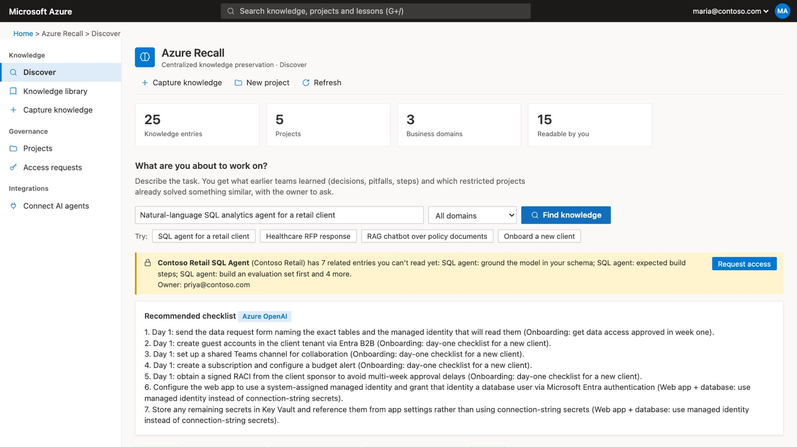
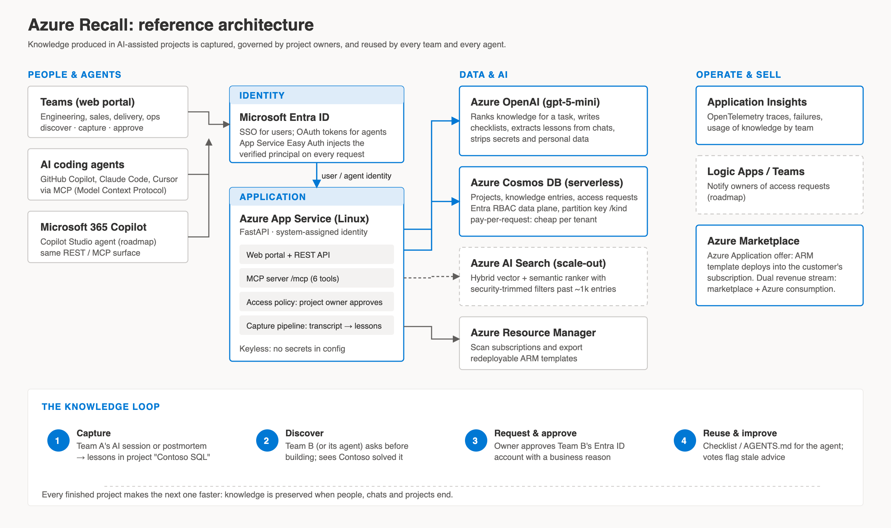
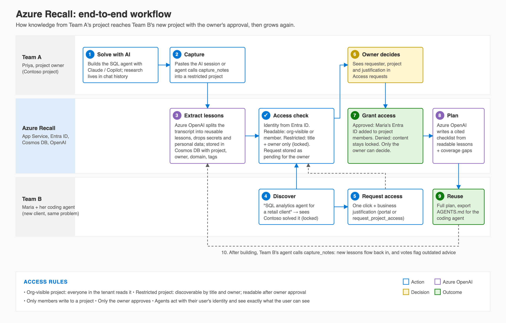
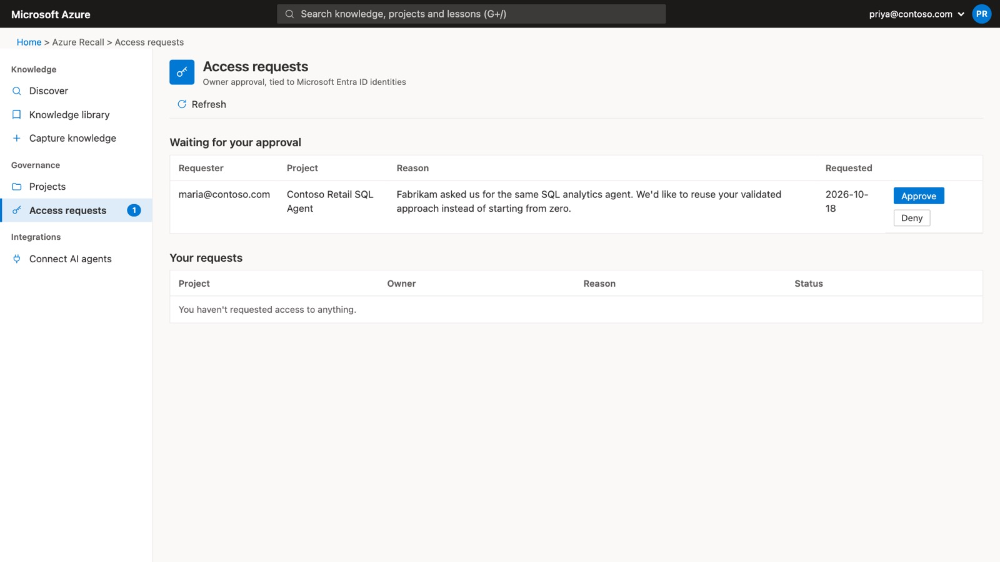
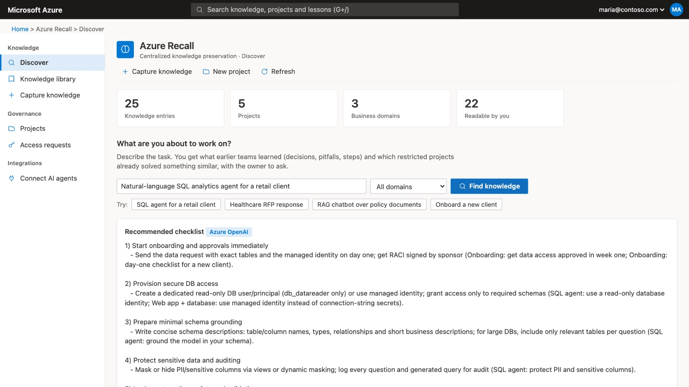
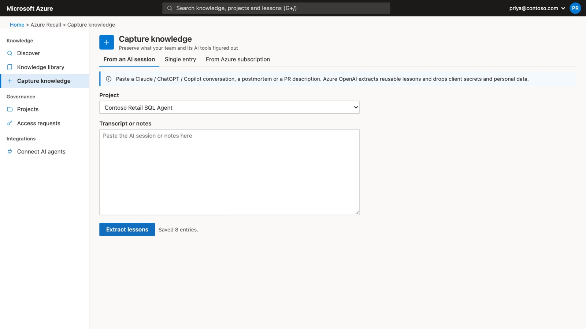
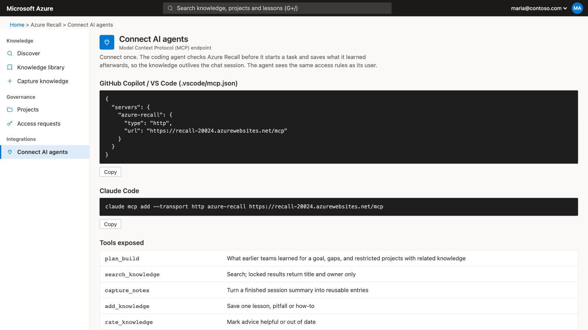

# Azure Recall

**Knowledge that outlives the project.** A centralized, owner-governed knowledge layer for teams and their AI agents, built on Azure.

> Microsoft Hackathon · Theme: **Knowledge Preservation**

**▶ [Watch the demo video (4:38)](docs/Azure-Recall-Demo.mp4)**



## The problem

Developers now solve most problems with AI assistants such as Claude, ChatGPT and GitHub Copilot. The research, investigation and trial and error happen inside a chat. When the project ends, the code is kept but **the knowledge stays locked in one team's chat history**.

When another client brings the same problem, a different team starts from zero. Client confidentiality also means companies can't simply make everything public.

## The solution

Azure Recall captures what teams and their AI tools learn, governs it through **projects with accountable owners** using **Microsoft Entra ID**, and returns it at the moment a person or coding agent starts similar work.

| | |
|---|---|
| **Capture** | Paste an AI session, postmortem or PR description. Azure OpenAI extracts reusable lessons and drops secrets and personal data. Agents can save lessons themselves over MCP. |
| **Discover** | Describe your task in plain language. Get an ordered checklist that cites its sources, the relevant lessons, coverage gaps, and restricted projects that already solved something similar. |
| **Govern** | Restricted knowledge is *discoverable* (title and owner) but readable only after the **project owner approves** an access request tied to the requester's Entra ID. |
| **Reuse** | From the web portal, REST API, or any coding agent (GitHub Copilot, Claude Code, Cursor) through the **Model Context Protocol**. Export a plan as `AGENTS.md`. |

Not just for code: the same model works for sales (RFP responses), delivery (onboarding playbooks) and any other business domain.

## Architecture



| Service | Role |
|---|---|
| **Azure App Service** (Linux) | Web portal, REST API and MCP endpoint `/mcp` |
| **Microsoft Entra ID** (Easy Auth) | Single sign-on; verified identity drives every access decision |
| **Azure Cosmos DB** (serverless) | Projects, knowledge entries, access requests |
| **Azure OpenAI** (gpt-5-mini) | Ranking, checklist generation, lesson extraction and redaction |
| **Managed identity + Azure RBAC** | Keyless access to Cosmos DB and Azure OpenAI; no secrets in configuration |
| **Application Insights** | OpenTelemetry tracing and adoption analytics |
| **Azure Marketplace** | Distributed as an Azure Application that deploys into the customer's subscription |

Roadmap: Azure AI Search (hybrid + semantic retrieval with security trimming), Logic Apps / Teams notifications for owners, and a Copilot Studio agent for Microsoft 365 Copilot.

## Workflow



| Request access | Owner approves | Full plan after approval |
|---|---|---|
|  |  |  |

| Capture from an AI session | Connect coding agents (MCP) |
|---|---|
|  |  |

## Quick start (local, no Azure needed)

```bash
python3 -m venv .venv && .venv/bin/pip install -r requirements.txt
.venv/bin/python seed.py                          # demo projects + knowledge into ./kb
AUTH_MODE=demo .venv/bin/uvicorn app:app --port 8000
# open http://localhost:8000
```

`AUTH_MODE=demo` adds a user switcher (top right) with three personas, so you can play both requester and owner:

| Persona | Role in the demo |
|---|---|
| `maria@contoso.com` | New team; discovers the locked project and requests access |
| `priya@contoso.com` | Owner of *Contoso Retail SQL Agent* and *Northwind Health RFP* (restricted) |
| `arjun@contoso.com` | Owner of *Fabrikam Policy Chatbot* and *Platform Baseline* (org-visible) |

Without Azure OpenAI configured, search falls back to keyword ranking, and capture splits notes by paragraph.

Run the tests (access control and API):

```bash
.venv/bin/python test_app.py
```

## Deploy to Azure

```bash
az login
infra/deploy.sh <resource-group> [suffix] [location]
```

This creates App Service, Cosmos DB (serverless), Azure OpenAI (gpt-5-mini) and Application Insights. It assigns managed-identity roles, seeds the demo data, deploys the app and prints the URL.

For production, turn on Entra ID sign-in and trust only its identity:

```bash
az webapp auth microsoft update -g <rg> -n <app> --create-new-app \
  --issuer https://login.microsoftonline.com/<tenant-id>/v2.0
az webapp auth update -g <rg> -n <app> --enabled true --action LoginWithAzureActiveDirectory
az webapp config appsettings set -g <rg> -n <app> --settings AUTH_MODE=entra
```

### Configuration

| Setting | Purpose |
|---|---|
| `AUTH_MODE` | `entra` (production: identity from App Service Easy Auth) or `demo` (persona switcher) |
| `COSMOS_ENDPOINT` | Cosmos DB account; if unset, JSON files in `KB_DIR` (default `./kb`) |
| `COSMOS_KEY` | Optional; managed identity is used when unset |
| `AZURE_OPENAI_ENDPOINT`, `AZURE_OPENAI_DEPLOYMENT` | Azure OpenAI; `AZURE_OPENAI_KEY` optional (managed identity when unset) |
| `APPLICATIONINSIGHTS_CONNECTION_STRING` | Enables OpenTelemetry export |
| `RECALL_API_KEY` | Optional shared key for headless agents (sees org-visible knowledge only) |

## Connect a coding agent (MCP)

```jsonc
// .vscode/mcp.json (GitHub Copilot agent mode)
{ "servers": { "azure-recall": { "type": "http", "url": "https://<app>.azurewebsites.net/mcp" } } }
```

```bash
claude mcp add --transport http azure-recall https://<app>.azurewebsites.net/mcp   # Claude Code
```

| Tool | What it does |
|---|---|
| `plan_build` | What earlier teams learned for a goal, gaps, and restricted projects with related knowledge |
| `search_knowledge` | Search; locked results return title and owner only |
| `capture_notes` | Turn a finished session summary into reusable entries |
| `add_knowledge` | Save one lesson |
| `rate_knowledge` | Mark advice helpful or out of date |
| `request_project_access` | Ask a project owner for read access |

## Access rules

| Action | Allowed for |
|---|---|
| Discover a title in a restricted project | Everyone signed in |
| Read an entry | Org-visible project, org-wide entry, or project owner / member |
| Write to a project | Owner / members |
| Approve or deny access | Project owner only |
| Delete an entry | Author or project member |

## Repository layout

```
app.py              FastAPI app: store (Cosmos DB / files), access policy, search, capture, REST + MCP
static/index.html   Web portal (Azure portal look, Fluent design tokens, light + dark)
seed.py             Demo projects across engineering, sales and operations
test_app.py         Access-control and API tests
mcp_server.py       Same MCP tools over stdio for local use
ingest.py           Bulk-import a folder (repo, docs) as knowledge
kb/                 Bundled demo knowledge (used locally and to seed Cosmos DB)
infra/deploy.sh     One-command Azure deployment (keyless)
marketplace/        Azure Marketplace package (ARM template + portal UI definition)
Dockerfile          Container image (used by the Marketplace template)
docs/               Demo video, solution document (PDF), architecture, diagrams, screenshots
```

## Documentation

- [Demo video (4:38, with voice-over)](docs/Azure-Recall-Demo.mp4): end-to-end walkthrough
- [Solution document (PDF)](docs/Azure-Recall-Solution.pdf): problem, solution, architecture, workflow, security, walkthrough, business model, roadmap
- [docs/SOLUTION.md](docs/SOLUTION.md): solution write-up
- [docs/ARCHITECTURE.md](docs/ARCHITECTURE.md): components, sequence diagram, data model, access rules, scaling
- [marketplace/PUBLISH.md](marketplace/PUBLISH.md): publishing to Azure Marketplace

## Business model

Offered through Azure Marketplace, Azure Recall deploys into the customer's own tenant, so their knowledge never leaves it. It creates a dual revenue stream for Microsoft: marketplace transactions and Azure consumption.
