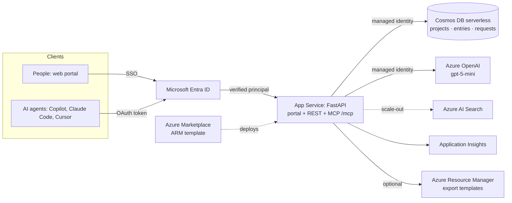
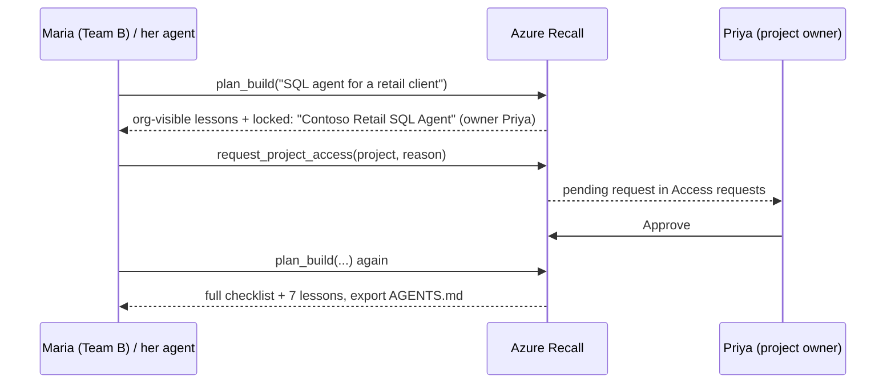

# Architecture

## Components

## Access flow

## Data model (Cosmos DB container `items`, partition key `/kind`)

| kind | Fields |
|---|---|
| `project` | id, name, owner (UPN), members[], visibility (`org` / `restricted`), domain, client, description |
| `entry` | id, title, body, tags[], project, domain, author, source, updated, helpful, outdated, template? |
| `request` | id, project, owner, requester, reason, status (`pending` / `approved` / `denied`), created, decided |

Locally (no `COSMOS_ENDPOINT`) the same documents are JSON files in `kb/`.

## Access rules (`app.py`)

| Action | Allowed for |
|---|---|
| Discover a title in a restricted project | everyone signed in |
| Read an entry | org-visible project, no project, or owner/member |
| Write to a project | owner/member |
| Approve or deny a request | project owner only |
| Delete an entry | author or project member |

## Identity

- `AUTH_MODE=entra`: user = `X-MS-CLIENT-PRINCIPAL-NAME` set by App Service Easy Auth after validating the Entra ID token (App Service removes any client-sent copy of the header). Agents call `/mcp` with an Entra access token; Easy Auth validates it the same way.
- `AUTH_MODE=demo`: persona switcher for demos and local development.
- `RECALL_API_KEY` (optional): a shared key for headless agents; it maps to a service identity that sees org-visible knowledge only.

## Scaling and cost

- Cosmos DB serverless: pay per request, near zero at idle; move to autoscale throughput for large tenants.
- Search: today Azure OpenAI ranks titles and tags (fine to roughly a thousand entries). Beyond that, index entries in **Azure AI Search** with vector + semantic ranking and a `project` filter computed from the caller's memberships (security trimming), so the LLM only sees permitted top-k results.
- App Service B1 → P1v3 with autoscale; stateless app, so scale-out is horizontal.
